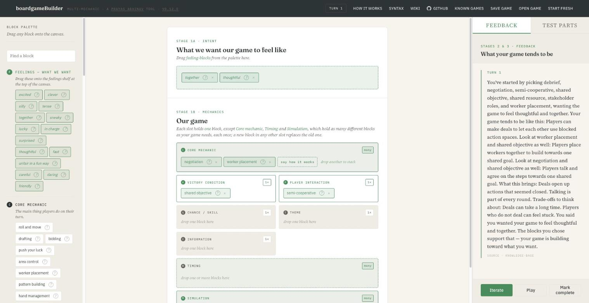

# boardgameBuilder

[](https://boardgame.blevn.xyz)
[](LICENSE)
[](https://www.python.org/)
[](https://fastapi.tiangolo.com/)
[](#how-the-feedback-is-made)
[](#privacy)
[](https://boardgame.blevn.xyz)
[](#the-blocks)
[](#checks)
[](#example-games)
[](#run-it-with-docker)

A small browser tool for designing a board game by putting blocks together and reading what the combination tends to produce.

**Try it:** https://boardgame.blevn.xyz · **Check its knowledge base:** https://boardgame-wiki.blevn.xyz · **My work:** https://prayasabhinav.net · **Write to me:** me@prayasabhinav.net



---

## Contents

1. [What it does](#what-it-does)
2. [Using it](#using-it)
3. [The blocks](#the-blocks)
4. [Simulation blocks for serious games](#simulation-blocks-for-serious-games)
5. [How the feedback is made](#how-the-feedback-is-made)
6. [Example games](#example-games)
7. [Known games, part tests and block questions](#known-games-part-tests-and-block-questions)
8. [Run it on your own machine](#run-it-on-your-own-machine)
9. [Run it with Docker](#run-it-with-docker)
10. [Changing the knowledge base](#changing-the-knowledge-base)
11. [The wiki](#the-wiki)
12. [Checks](#checks)
13. [Files](#files)
14. [Privacy](#privacy)
15. [Status and how to help](#status-and-how-to-help)
16. [References](#references)
17. [Licence](#licence)

---

## What it does

The screen has three columns.

- **Left: the palette.** Seven groups of blocks for the parts of a game, and a set of feelings.
- **Centre: the canvas.** A shelf for the feelings you want the game to have, and one slot for each group of blocks.
- **Right: the feedback.** Each press of **Iterate** reads the canvas and says what the combination tends to produce, what it brings, its trade-offs, any clash between blocks, whether the blocks serve the feelings you picked, and real games built on something similar where one has been checked.

You change a block, press Iterate again and see what moved. **Mark complete** writes a closing summary and locks the canvas.

## Using it

1. Drag one or more **feelings** (tense, clever, together, sneaky…) onto the shelf at the top.
2. Drag **blocks** into the slots. A block only fits its own slot.
3. **Core mechanic** and **Simulation** take as many blocks as you like. Every other slot takes one, and a new block replaces the old one.
4. Press **Iterate**. Each press is one turn of design; the panel keeps the history.
5. Press the **?** on any block for a short description and a drawing.
6. When a block has questions about how it works in your game, they open as you drop it; answer any you can, and change them later from the line under the block.
7. **Test parts**, beside the feedback, has short tests of one block, or two together, to play with things at hand; say how each felt.
8. Press **Mark complete** for the summary, which ends with your answers and test notes in your own terms. **Start fresh** in the header clears everything.

Your design is kept in your browser, so a refresh does not lose it. **Save game** in the header downloads it as a Markdown file: the feelings, the blocks and every turn of feedback, readable on its own, ending with the saved state. **Open game** reads that file back, in any browser or on another day, and carries on from the same turn. The steps also open on a first visit, and **How it works** in the header shows them again.

It works for one person on a laptop and for a group around one big screen.

## The blocks

| Group | Blocks | Slot holds |
|---|---|---|
| Core mechanic | roll and move, drafting, bidding, push your luck, area control, worker placement, pattern building, hand management, trick-taking, negotiation, set collection, tile placement, call and response, playing in silence, change the rules, role-play, dexterity, drawing the map | many |
| Victory condition | race to finish, most points, last standing, cooperative survival, shared objective, hidden personal goal, narrative completion, no objective, set your own goal, one loser, keep the game going, cannot be won | one |
| Player interaction | solo in parallel, direct confrontation, indirect via board, fully cooperative, semi-cooperative, team vs team, traitor, playing by letter, absent player, game master, public game | one |
| Chance or skill | mostly chance, chance with mitigation, skill with luck, mostly skill, chance read as a sign, attunement, dice tell the story | one |
| Theme | abstract, historical, fantasy, science fiction, everyday life, absurd, educational, real-world issue, poetic, ritual or sacred, mortality and loss, war and conquest | one |
| Information visibility | full information, hidden hands, hidden identity, deduction, bluffing, rules you discover, one knows, cannot say, map revealed as you go | one |
| Simulation | model a system, stakeholder roles, shared resource, delayed effects, try a rule, debrief, irreversible change, real-time span, rules make an argument, stakes outside the game, points stand for values, rehearse a future | many |

Fourteen of the blocks, from role-play to rehearse a future, come from ideas of Dhruv Jani's; the wiki credits him on each of their entries. Where each of the 31 blocks added on 16 October 2026 came from, with references checked against Crossref, is in [`docs/block-sources.md`](docs/block-sources.md).

**Feelings (15):** excited, clever, silly, tense, together, sneaky, lucky, in charge, surprised, thoughtful, fast, unfair in a fun way, careful, daring, friendly.

Which slots stack is a field on each group in `palette.py` (`"multi": True`); the page reads it from there.

## Simulation blocks for serious games

These are for games that model a real problem so that the people playing can work on it: a shared water supply, unequal starting points, a rule nobody has tried yet.

| Block | What it means for the players |
|---|---|
| model a system | The board works like a real system, so a move has the effect it would have in life. |
| stakeholder roles | Each player plays a real group with its own needs. |
| shared resource | Everyone draws from one limited thing; taking too much leaves less for all. |
| delayed effects | A choice shows its effect only rounds later. |
| try a rule | Players agree a rule for everyone and play on to see what it changes. |
| debrief | After play, players compare what happened with the real problem. |

I checked the six against the literature before building them. Roles, the model, policies and the debriefing are among the elements Duke lists for a gaming-simulation (Duke, 2011). Games used to test a draft regulation show consequences that in real life arrive with a long delay, and let people try a rule before it applies (Olejniczak, Wolański and Widawski, 2018). The shared resource is the common-pool resource game, with four decades of experiments behind it (Malézieux and Spiegelman, 2025). Villages in Andhra Pradesh played collective-action games about their groundwater, followed by a community debrief, and more of them took up water registers and rules afterwards than comparable villages (Meinzen-Dick et al., 2018). Role-play is at the centre of serious games for natural resource management (Edwards et al., 2019), and the debriefing is where play is connected back to the real situation (Peters and Vissers, 2004). The debrief block's four questions are Duke's: what happened, why, how it compares with the real world, and what would happen if something changed.

## How the feedback is made

No AI model runs while you use the tool, and nothing is generated on the fly. The same canvas always gives the same text.

```
You drag blocks onto the canvas
        ↓
rules.py matches the canvas against the knowledge base
  (pairs, triads, conflicts, feelings, theme lines)
        ↓
templates.py joins the matched entries' own sentences,
  using the fixed joining phrases in bridges.py
        ↓
The paragraph appears in the right-hand panel
```

The judgement (which blocks work together, what they tend to produce, what clashes, which feelings a block serves) lives in the knowledge base, where anyone can read and change it. The code only finds the matching entries and joins their sentences. `bridges.py` holds the joining phrases, with a few versions of each, chosen by the sentence they introduce.

The knowledge base has two parts:

- **`interactions.json`, the curated part:** 51 pairs, 15 triads, 5 conflicts and 15 feelings, each with a tendency, pros, cons and, where checked, example games. It was assembled in April 2026 with Perplexity search and BoardGameGeek, then checked again in October 2026 (see [Example games](#example-games)).
- **`interactions-drafted.json`, the drafted part:** 2,058 more pairs so that every combination of blocks has an entry, a line for each of the 12 themes, and a judgement for every feeling against every block (supports, works against, or neither). Every drafted entry is marked `drafted-20261016-unreviewed`, names no games, and loads after the curated ones, so a curated entry is always found first.

Themes are treated as colour, not mechanics: each theme has one line about what it adds, and themes are not paired with other blocks.

## Example games

Example games appear at the end of the feedback ("Games that do something like this…") only when a curated pair or triad is on the canvas. The drafted entries name none, because a claim that a real game uses two mechanisms has to be checked first.

In October 2026 every example game in the curated pairs and triads was checked against its full BoardGameGeek tag list. A game was removed when it lacks a mechanism it was named for, using tags BoardGameGeek applies reliably, or when a *full information* claim met a hidden-information tag or rule. 26 games were removed this way, each with its reason kept in the entry's `exemplars_removed`; one (Skull) is kept and marked in `exemplars_unconfirmed`; 60 of the 66 entries still name at least one game. The rule is in `drafted/bgg_check.py`, the tags in `drafted/bgg-tags.json` and every verdict in `drafted/bgg-verdicts.json`.

## Known games, part tests and block questions

Three things carried over on 16 October 2026 from an April 2026 prototype of this tool, edited before use:

- **Known games** in the header lists ten short games to play with paper, dice, coins or cards, such as Pig, a small Hanabi, a paper auction and charades. Each has illustrated steps, things to talk about afterwards, and an animation of the game being played, followed by questions. Questions about what happened are marked right or wrong; questions about what a designer would change have no right answer and are left to talk about. Nothing is locked: designing works whether or not a game has been played. The games are in `games.json`. Their rules, animations and answers were checked against each other, not against a published rulebook; several came over with scores that did not add up or rules the animation contradicted, and were corrected.
- **Test parts** holds a short test for thirteen blocks, and three tests of two blocks together, in `part-tests.json`. What players say about a test (how it felt, whether it matched what they wanted, one thing they would change) is kept with the design.
- **Block questions**, in `block-questions.json`, ask how 25 of the blocks work in this game: how much a bust costs in push your luck, how big the hands are in hand management. The answers are the designers' own. The closing summary says them back, with the test notes, in fixed words; they add no knowledge-base claim and change none of the feedback.

All three are kept in the saved Markdown file, and none of them uses a model.

## Run it on your own machine

You need Python 3.10 or newer.

```bash
git clone https://github.com/prayasabhinav/boardgame-builder.git
cd boardgame-builder
./start.sh
```

Then open http://127.0.0.1:8787. The first run creates a private Python environment in the folder (`.venv-darwin/` or `.venv-linux/`) and installs three packages; later runs start in a second or two. `Ctrl + C` stops it.

To use another port: `PORT=9001 ./start.sh`. If the script is not executable, run `bash start.sh`.

No key or account is needed. Nothing leaves your machine apart from the page loading its fonts from Google Fonts.

## Run it with Docker

```bash
docker build -t boardgame-builder .
docker run -p 8080:80 boardgame-builder
```

Then open http://127.0.0.1:8080. The container listens on port 80, writes nothing to disk and needs no environment variables. `captain-definition` is there for CapRover, if that is how you deploy.

## Changing the knowledge base

- **Curated entries:** edit `interactions.json` directly.
- **Drafted entries:** edit the plain-text files in `drafted/` and rebuild:
  - pairs, one per line: `block-a+block-b | tendency | pro | pro | con | con`
  - `drafted/themes.txt`: `theme-id | sentence`
  - `drafted/feelings.txt`: `feeling | + blocks it supports | - blocks it works against` (every other block is judged *neither*)

  ```bash
  python drafted/build.py
  ```

  The build refuses a duplicate, an unknown block, a drafted feeling link that contradicts a curated one, and words from a short list of verdicts (good, bad, best, should, must and the like), because the feedback describes tendencies and leaves the judging to the designer.
- **Joining phrases:** edit `bridges.py`.
- **Block descriptions and drawings** (the **?** button): `block_meta.py`.
- **Groups and blocks:** `palette.py`. A new block needs a description in `block_meta.py`, a display name in `templates.py`, and pair entries so `check.py` still passes.

## The wiki

Every entry in the knowledge base is also on a public wiki, https://boardgame-wiki.blevn.xyz, one page per entry. Anyone can read it. People who sign in with GitHub or Google can record a check under their own name (verified against a source, or validated by trying it with people at a table), propose a change to an entry, or propose a new triad, conflict, block or feeling. Proposals wait for an editor, and anyone can apply to become one from the wiki (sign in, then *Join the editors*). Approved proposals reach this repository and the live tool by themselves: every half hour a GitHub Action runs `wiki/pull.py`, rebuilds the drafted entries, runs `check.py`, and only if the check passes commits the change here and redeploys the tool and the wiki (`.github/workflows/wiki-sync.yml`). A change that breaks the check stops there and goes nowhere. The wiki's code and how to run your own are in [`wiki/`](wiki/README.md).

## Checks

```bash
python check.py
```

`check.py` builds every possible two-block canvas (2,924 of them) and confirms each gets text from the knowledge base, then picks each of the 15 feelings with every canvas (43,860 cases) and confirms each feeling is said. Larger canvases always contain a covered pair. It exits with an error and names the first gaps if anything is missing, so run it after any change to the knowledge base or the blocks.

## Files

| File | What it is |
|---|---|
| `app.py` | The FastAPI server: serves the page, `/palette`, `/tests`, `/games`, `/narrate` and `/complete` |
| `rules.py` | Matches a canvas against the knowledge base |
| `templates.py` | Turns the matches into the feedback paragraph and the closing summary |
| `bridges.py` | The fixed joining phrases between knowledge-base sentences |
| `palette.py` | The groups, their blocks, which slots stack, and the feelings |
| `block_meta.py` | Each block's description and drawing |
| `interactions.json` | The curated knowledge base |
| `interactions-drafted.json` | The drafted knowledge base, built from `drafted/` |
| `drafted/` | Plain-text sources for the drafted entries, the build script, and the BoardGameGeek check |
| `wiki/` | The public wiki of the knowledge base, and `pull.py`, which carries approved proposals into it |
| `wiki-applied.json` | The wiki proposals already carried into the knowledge base (made by `wiki/pull.py`) |
| `check.py` | The coverage check |
| `games.json`, `part-tests.json`, `block-questions.json` | The known games, the part tests and the block questions |
| `mechanics-shortlist.md`, `feeling-blocks.md` | Reference notes on the mechanic and feeling blocks |
| `static/` | The page: `index.html`, `app.js`, `style.css`, `base-ui.css`, and `og.png`, the link-preview card |
| `docs/` | The screenshot, and `make_og.py`, which draws `static/og.png` from it |
| `start.sh` | One-command start on macOS or Linux |
| `Dockerfile`, `captain-definition` | Container build |
| `requirements.txt` | fastapi, uvicorn, pydantic |

## Privacy

There are no analytics, counters or tracking of any kind. The server keeps no request log and stores nothing: your design lives only in your browser's local storage, and a saved game is a file on your own computer that the server never sees. The hosted copy is the same code. The wiki is separate: it keeps the records and proposals people make there, under the names they sign in with, and nothing else (see [`wiki/README.md`](wiki/README.md#privacy)).

## Status and how to help

The tool is new. The curated knowledge base has been checked; much of the drafted part is still a first draft. I would like people to try it and tell me where a reading is wrong, a block is missing, or a game example does not hold: students, teachers, game designers, anyone who has made a game on paper.

The easiest way is the [wiki](https://boardgame-wiki.blevn.xyz): open the entry, add a record or propose a change. You can also write to me at me@prayasabhinav.net, or open an issue here.

## References

Duke, R. D. (2011). Origin and evolution of policy simulation: A personal journey. *Simulation & Gaming*, 42(3), 342–358. https://doi.org/10.1177/1046878110367570

Edwards, P., Sharma-Wallace, L., Wreford, A., Holt, L., Cradock-Henry, N. A., Flood, S., and Velarde, S. J. (2019). Tools for adaptive governance for complex social-ecological systems: A review of role-playing-games as serious games at the community-policy interface. *Environmental Research Letters*, 14(11), 113002. https://doi.org/10.1088/1748-9326/ab4036

Malézieux, A., and Spiegelman, E. (2025). An anatomical review of the common pool resource game. *Experimental Economics*, 28(3), 468–491. https://doi.org/10.1017/eec.2024.6

Meinzen-Dick, R., Janssen, M. A., Kandikuppa, S., Chaturvedi, R., Rao, K., and Theis, S. (2018). Playing games to save water: Collective action games for groundwater management in Andhra Pradesh, India. *World Development*, 107, 40–53. https://doi.org/10.1016/j.worlddev.2018.02.006

Olejniczak, K., Wolański, M., and Widawski, I. (2018). Regulation crash-test: Applying serious games to policy design. *Policy Design and Practice*, 1(3), 194–214. https://doi.org/10.1080/25741292.2018.1504372

Peters, V. A. M., and Vissers, G. A. N. (2004). A simple classification model for debriefing simulation games. *Simulation & Gaming*, 35(1), 70–84. https://doi.org/10.1177/1046878103253719

## Licence

GNU Affero General Public License v3.0. See [LICENSE](LICENSE). If you run a changed version for others over a network, you share your changes under the same licence.

Made by Prayas Abhinav, https://prayasabhinav.net
