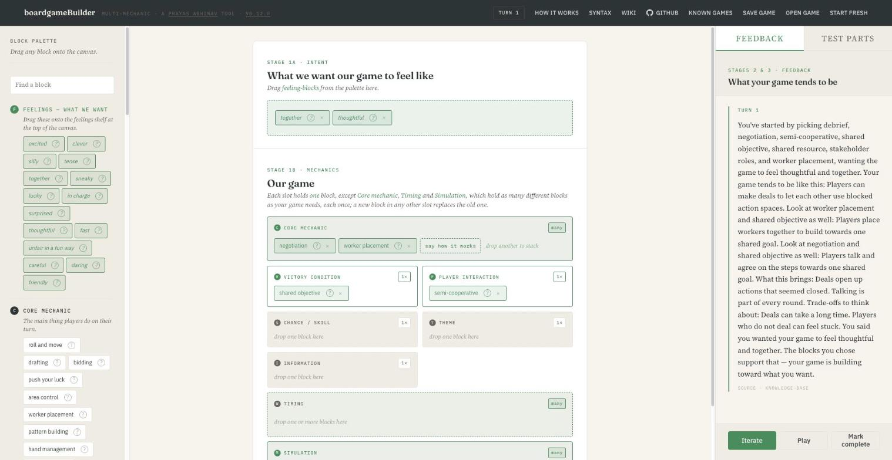

# boardgameBuilder

[](https://boardgame.syntax.prayasabhinav.net)
[](CHANGELOG.md)
[](LICENSE)
[](https://www.python.org/)
[](https://fastapi.tiangolo.com/)
[](#how-the-feedback-is-made)
[](#privacy)
[](https://boardgame.syntax.prayasabhinav.net)
[](#the-blocks)
[](#checks)
[](#example-games)
[](#run-it-with-docker)

A small browser tool for designing a board game by putting blocks together and reading what the combination tends to produce.

**Try it:** https://boardgame.syntax.prayasabhinav.net · **Check its knowledge base:** https://boardgame-wiki.syntax.prayasabhinav.net · **Its syntax:** https://syntax.prayasabhinav.net/board-game/ · **My work:** https://prayasabhinav.net · **Write to me:** me@prayasabhinav.net



---

## Contents

1. [What it does](#what-it-does)
2. [Using it](#using-it)
3. [Playing it on screen](#playing-it-on-screen)
4. [The blocks](#the-blocks)
5. [Simulation blocks for serious games](#simulation-blocks-for-serious-games)
6. [How the feedback is made](#how-the-feedback-is-made)
7. [Example games](#example-games)
8. [Known games, part tests and block questions](#known-games-part-tests-and-block-questions)
9. [Run it on your own machine](#run-it-on-your-own-machine)
10. [Run it with Docker](#run-it-with-docker)
11. [Changing the knowledge base](#changing-the-knowledge-base)
12. [The wiki](#the-wiki)
13. [Checks](#checks)
14. [Files](#files)
15. [Privacy](#privacy)
16. [Status and how to help](#status-and-how-to-help)
17. [References](#references)
18. [Licence](#licence)

---

## What it does

The screen has three columns.

- **Left: the palette.** The feelings at the top, then nine groups of blocks: the kind of fun the game is built to give, and eight for the parts of a game. A search box above them shows only the blocks whose name or description holds the words typed, or a whole group when its name is typed; Esc clears it.
- **Centre: the canvas.** A shelf for the feelings you want the game to have, one slot for each group of blocks, and a box below them for writing how the game plays.
- **Right: the feedback.** Each press of **Iterate** reads the canvas and says what the combination tends to produce, what it brings, its trade-offs, any clash between blocks, whether the blocks serve the feelings you picked, and real games built on something similar where one has been checked.

You change a block, press Iterate again and see what moved. **Mark complete** writes a closing summary and locks the canvas; **Develop further**, under the summary, opens the same design again and carries on from the turn it stopped at.

## Using it

1. Drag one or more **feelings** (tense, clever, together, sneaky…) onto the shelf at the top.
2. Drag **blocks** into the slots. A block only fits its own slot.
3. **Core mechanic**, **Timing** and **Simulation** hold as many different blocks as your game needs, each once. Every other slot holds one, and a new block replaces the old one.
4. Write **how the game plays** in the box under the slots. Type **@** to tag a block on the canvas: the tag is marked in the text, the box it sits in is tagged with it, the tags are listed under the text by box (*Core mechanic › roll and move*), a tagged block is filled in, with a dark border, and its slot carries an **@** at its corner. A tag whose block has left the canvas is listed as no longer on it.
5. Press **Iterate**. Each press is one turn of design; the panel keeps the history.
6. Press the **?** on any block for a short description and a drawing. The feelings have none.
7. When a block has questions about how it works in your game, they open as you drop it; answer any you can, and change them later from the line under the block.
8. **Test parts**, beside the feedback, has short tests of one block, or two together, to play with things at hand; say how each felt.
9. Press **Play** to play the design on screen (see [Playing it on screen](#playing-it-on-screen)).
10. Press **Mark complete** for the summary, which ends with your answers and test notes in your own terms. **Develop further** under it opens the design again; **Start fresh** in the header clears everything.

Your design is kept in your browser, so a refresh does not lose it. **Save game** in the header downloads it as a Markdown file, named for its core mechanics with six characters that make each file's name its own: the feelings, the blocks, how the game plays with its tags by box, and every turn of feedback, readable on its own, ending with the saved state. **Open game** reads that file back, in any browser or on another day, and carries on from the same turn. The steps also open on a first visit, and **How it works** in the header shows them again.

Every view has its own address, so it can be linked, reloaded and reached with Back: `#games` for the known games, `#games/pig` for one of them, `#games/pig/watch` to watch it, `#how-it-works`, `#blocks/push-your-luck` for a block, `#tests` for the part tests, and `#play` to play the design on screen.

## Ideas, and feedback from books

The **Ideas** tab sits beside the feedback. It holds an alphabetical glossary and the key ideas of 25 books and 6 research papers on play, games and their rules, in plain words, each with the book or paper and the page or chapter it comes from. A search box finds a word or an idea, and the books are listed in full at the end of the tab. Every line was checked against its source by a reader who had not written it. A line stayed only if that reader found the passage and code then found the reader's copied words in the book's text; the lines that failed are kept aside in `ideas/removed/`. Six of these books, on game rules and their effects, also supply some of the feedback, with the same kind of citation. They describe 65 blocks the palette did not have, such as a trump suit, sowing seeds and the pie rule. Those blocks are in the palette now, under *From the rule books, tentative* in each group, and stay there until they have been tried in a class. Every pair they make has a drafted entry. All of it is on the wiki to be checked.

## Teaching remotely

The knowledge base says some pairs of blocks pull against each other, such as *fully cooperative* with *last standing*, and the tool calls these pairs unusual. Because an unusual pair can be where a new game starts, the tool lets anyone place one. It marks both blocks *unusual*. A palette block that would make such a pair with the canvas is marked before it is dropped. Other pairs are marked the same way when the two blocks cannot both be true of one game, and being new or unusual is not a reason: `review-model/rules.py` reads a table of what each core mechanic makes or settles and which blocks say otherwise and gives the reason. It also fits a small model on that table and on how three independent readers answered, for 720 sampled pairs, whether both blocks can be true of the same game, and writes for every pair a probability that the two clash; the teacher's page shows it as a percentage beside each pair. That model is **khatka**, released on its own, with its data, at https://github.com/prayasabhinav/khatka.

A teacher who is not at the table can see these pairs as they happen. They open `/teacher`, sign in, and press **Start a class**, which gives a five-letter code. Students do not sign in. A server's operator makes the teacher logins with `python teacher_logins.py <file> <name> …`, which writes each name and a new password to the file and prints the value to set as `TEACHER_LOGINS` on the server, which holds only salted hashes; `TEACHER_SECRET` signs the week-long session. With no `TEACHER_LOGINS`, no class can be started. Each student presses **Join a class** in the header and types the code and their name. From then on the teacher's page, refreshed every five seconds, lists the name of each student whose canvas holds an unusual pair, with the pair and their blocks. That is how the teacher knows whom to review. A student drops off the list as soon as the pair leaves their canvas. **leave** in the header takes them out of the class. The teacher's page also gives a join link that fills in the code (`#join/<code>`), shows the code full screen for a projector, groups the list by student or by pair, lets the teacher mark a student as looked at until their pairs change (kept in the teacher's browser), and shows for the whole class how many students joined, how many changes they made and how many placed an unusual pair. A student in a class can press **Explore for 2 hours** in the header: for two hours the teacher still sees their unusual pairs, marked as exploration time and not for review, and the student can stop it early.

It works for one person on a laptop and for a group around one big screen.

## Playing it on screen

**Play**, beside Iterate, plays the design on the canvas. Each block the screen can play has a rule written for it in `static/play-engine.js`, and the rules join into one game: a turn is one move, chosen from the moves the blocks offer, and the rounds, the scoring and the end follow from the victory condition. Nothing is generated; the same choices and the same dice give the same game.

55 of the 86 blocks have a rule, among them rolling and moving, pushing your luck, drafting, bidding, placing workers and pieces, patterns, hands and tricks, sets, tiles, a shared resource that refills the way a real one does, a pressure the team has to hold back, a hidden card to work out and a secret rule to find. The 12 themes name the pieces. The other 19 happen between people, such as negotiation, role-play, playing in silence or a debrief: the setup lists them under *You play at the table*, each with what to do, and they stay beside the board while you play. A few get help from the screen: it can move the points a negotiation agreed, and it asks the debrief questions at the end. The 65 tentative blocks from the rule books have no rule on screen yet. A design that has one plays without it; 3,000 random canvases that included them all played to the end without failing.

Each seat is a **person** or **fixed rules**. A fixed-rule player is played by the screen and always takes the move its rule values most, with a little chance between moves of nearly equal value. It fills a table; it does not play the way people do. When players keep secrets (hidden hands, secret goals, a traitor, secret sides, bluffs), the screen hides them and asks for the screen to be passed before each person's move. With **no turns**, whoever presses their key first (A, L, Z, M or Q, or a tap on their name) makes the next move. **Timed turns** give each move a clock, which shortens if the game is **accelerated**; when it runs out, a move is made at random. **Sedated** holds every move for a breath first.

The closing screen gives the result and the scores and, when the canvas has the blocks for them, what the rules rewarded, the debrief questions, and the feelings you chose with the question of whether the game felt that way. With **irreversible change**, the shared resource stays where it ended for the next game in the same browser.

**Full screen** gives the table the whole screen, for a group around one display. **Share link** gives an address that carries the design itself: the blocks and your answers to their questions. Whoever opens it gets the same game ready to play, and their own canvas stays as it is.

A share link also carries questions for whoever plays it, which makes it a playtest. **Share link** opens them for editing above the address: five to start with (what the players spent their turns on, a moment that needed thought, whether the result came from choices or luck, which rule they would change, and, if you chose feelings, whether it felt that way), each one changeable or removable, up to twelve. The address changes as you edit. The player sees the questions before starting and answers them on the closing screen; **Copy my answers** puts the answers, the blocks, the result and everything that happened in the game into one text to send back however they like. Nothing is sent or kept by the tool.

## The blocks

| Group | Blocks | Slot holds |
|---|---|---|
| Core mechanic | roll and move, drafting, bidding, push your luck, area control, worker placement, pattern building, hand management, trick-taking, negotiation, set collection, tile placement, call and response, playing in silence, change the rules, role-play, dexterity, drawing the map | many |
| Victory condition | race to finish, most points, last standing, cooperative survival, shared objective, hidden personal goal, narrative completion, no objective, set your own goal, one loser, keep the game going, cannot be won | one |
| Player interaction | solo in parallel, direct confrontation, indirect via board, fully cooperative, semi-cooperative, team vs team, traitor, playing by letter, absent player, game master, public game | one |
| Chance or skill | mostly chance, chance with mitigation, skill with luck, mostly skill, chance read as a sign, attunement, dice tell the story | one |
| Theme | abstract, historical, fantasy, science fiction, everyday life, absurd, educational, real-world issue, poetic, ritual or sacred, mortality and loss, war and conquest | one |
| Information visibility | full information, hidden hands, hidden identity, deduction, bluffing, rules you discover, one knows, cannot say, map revealed as you go | one |
| Timing | take turns, everyone at once, no turns, timed turns, real-time span, sedated, accelerated | many |
| Simulation | model a system, stakeholder roles, shared resource, delayed effects, try a rule, debrief, irreversible change, rules make an argument, stakes outside the game, points stand for values, rehearse a future | many |

**From the rule books, tentative (65):** added on 6 November 2026 from six books of game rules. `book-blocks.json` gives the books and pages behind each one.

- *Core mechanic:* ask for what they hold, bet against the bank, betting on a throw, betting on your hand, build your own side, calling a contract, capture and convert, capture and rescue, capture by surrounding, catch-up help, chance alone decides, chase and tag, choose your target, connecting across the board, counter cycle, declaring combinations, different powers for each player, doubling the stakes, forced capture, grow stronger over time, a list that keeps growing, handicap, hide and find, jumping over pieces, keep some dice and roll the rest, landing sends a piece back, make a row and take a piece, making words from letters, matching the open ends, melding, one-use powers, the other player has a say, passing a message along, passing cards, pie rule, promotion, relay, a shape that cannot be captured, scoring cards named in advance, shared cards in the middle, shared pot, sowing seeds, spare hand, special squares, spend to use, split your forces, stop on a signal, swapping cards for new ones, taking the discard pile, trump suit, two games at once, wild cards, wraparound board, yes-or-no questions
- *Victory condition:* beat the layout, best of several games, fewest points, finish on an exact number, play to lose
- *Player interaction:* one against the rest, playing alone
- *Information visibility:* a hand laid face up, secret scores
- *Timing:* extra turn, staged game

The 42 kinds of fun come from the books on play and games in the research library behind the Ideas tab (Caillois, Csikszentmihalyi, Huizinga, Koster, McGonigal, Macklin and Sharp, Nguyen, DeKoven, Elias, Garfield and Gutschera, and others); each block names its books under ?, and `kinds-of-fun.json` gives the line in each book. A design needs at least one before it can be marked complete.

Fourteen of the blocks, from role-play to rehearse a future, come from ideas of Dhruv Jani's; the wiki credits him on each of their entries. Where each of the 31 blocks added on 16 October 2026 came from, with references checked against Crossref, is in [`docs/block-sources.md`](docs/block-sources.md).

**Feelings (15):** excited, clever, silly, tense, together, sneaky, lucky, in charge, surprised, thoughtful, fast, unfair in a fun way, careful, daring, friendly.

Which slots stack is a field on each group in `palette.py` (`"multi": True`); the page reads it from there.

## Simulation blocks for serious games

These are for games that model a real problem so that the people playing can work on it: a shared water supply, unequal starting points, a rule nobody has tried yet.

| Block | What it means for the players |
|---|---|
| model a system | The board works like a real system, so a move has the effect it would have in life. |
| stakeholder roles | Each player plays a real group with its own needs. |
| shared resource | Everyone draws from one limited thing; taking too much leaves less for all. |
| delayed effects | A choice shows its effect only rounds later. |
| try a rule | Players agree a rule for everyone and play on to see what it changes. |
| debrief | After play, players compare what happened with the real problem. |

I checked the six against the literature before building them. Roles, the model, policies and the debriefing are among the elements Duke lists for a gaming-simulation (Duke, 2011). Games used to test a draft regulation show consequences that in real life arrive with a long delay, and let people try a rule before it applies (Olejniczak, Wolański and Widawski, 2018). The shared resource is the common-pool resource game, with four decades of experiments behind it (Malézieux and Spiegelman, 2025). Villages in Andhra Pradesh played collective-action games about their groundwater, followed by a community debrief, and more of them took up water registers and rules afterwards than comparable villages (Meinzen-Dick et al., 2018). Role-play is at the centre of serious games for natural resource management (Edwards et al., 2019), and the debriefing is where play is connected back to the real situation (Peters and Vissers, 2004). The debrief block's four questions are Duke's: what happened, why, how it compares with the real world, and what would happen if something changed.

## How the feedback is made

No AI model runs while you use the tool, and nothing is generated on the fly. The same canvas always gives the same text.

```
You drag blocks onto the canvas
        ↓
rules.py matches the canvas against the knowledge base
  (pairs, triads, conflicts, feelings, theme lines)
        ↓
templates.py joins the matched entries' own sentences,
  using the fixed joining phrases in bridges.py
        ↓
The paragraph appears in the right-hand panel
```

The judgement (which blocks work together, what they tend to produce, what clashes, which feelings a block serves) lives in the knowledge base, where anyone can read and change it. The code only finds the matching entries and joins their sentences. `bridges.py` holds the joining phrases, with a few versions of each, chosen by the sentence they introduce.

The knowledge base has two parts:

- **`interactions.json`, the curated part:** 51 pairs, 15 triads, 5 conflicts and 15 feelings, each with a tendency, pros, cons and, where checked, example games. It was assembled in April 2026 with Perplexity search and BoardGameGeek, then checked again in October 2026 (see [Example games](#example-games)).
- **`interactions-drafted.json`, the drafted part:** 2,481 more pairs so that every combination of blocks has an entry, a line for each of the 12 themes, and a judgement for every feeling against every block (supports, works against, or neither). Every drafted entry is marked `drafted-20261016-unreviewed`, names no games, and loads after the curated ones, so a curated entry is always found first.

Themes are treated as colour, not mechanics: each theme has one line about what it adds, and themes are not paired with other blocks.

## Example games

Example games appear at the end of the feedback ("Games that do something like this…") only when a curated pair or triad is on the canvas. The drafted entries name none, because a claim that a real game uses two mechanisms has to be checked first.

In October 2026 every example game in the curated pairs and triads was checked against its full BoardGameGeek tag list. A game was removed when it lacks a mechanism it was named for, using tags BoardGameGeek applies reliably, or when a *full information* claim met a hidden-information tag or rule. 26 games were removed this way, each with its reason kept in the entry's `exemplars_removed`; one (Skull) is kept and marked in `exemplars_unconfirmed`; 60 of the 66 entries still name at least one game. The rule is in `drafted/bgg_check.py`, the tags in `drafted/bgg-tags.json` and every verdict in `drafted/bgg-verdicts.json`.

## Known games, part tests and block questions

Three things carried over on 16 October 2026 from an April 2026 prototype of this tool, edited before use:

- **Known games** in the header lists 47 short games to play with paper, dice, coins or cards, each chosen for what it shows a designer: seven made for the April prototype (Pig, a small Hanabi, a paper auction and others), 38 classic, traditional and designed games (among them Eleusis, Nomic, The Mind, Sprouts, Hex, Aadu Puli Attam, Moksha Patam, the Royal Game of Ur, Mendikot and Set), and two games of mine, All or Nothing and 3 Quarters. Each card opens with **What it shows a designer**, the idea that playing it makes felt. Each has its credits (who made it where that is on record, *Traditional* where nobody is, and what this version changes), illustrated steps that say who starts, how it ends and what happens on a tie, things to talk about afterwards, and the blocks it is made of. Some also have an animation of the game being played, followed by questions: questions about what happened are marked right or wrong; questions about what a designer would change have no right answer and are left to talk about. **Download as a design** gives the game as a Markdown file, and **Open game** puts its blocks on the canvas to design from. Nothing is locked: designing works whether or not a game has been played. The games are in `games.json`, and `known_games.py` writes and reads their files. The rules of the classic games follow the sources listed with each; each game's blocks were checked against its BoardGameGeek tags where it has an entry (`drafted/bgg_check.py`). Anyone signed in to the wiki can propose a new game as a file in the same shape.
- **Test parts** holds a short test for thirteen blocks, and three tests of two blocks together, in `part-tests.json`. What players say about a test (how it felt, whether it matched what they wanted, one thing they would change) is kept with the design.
- **Block questions**, in `block-questions.json`, ask how 25 of the blocks work in this game: how much a bust costs in push your luck, how big the hands are in hand management. The answers are the designers' own. The closing summary says them back, with the test notes, in fixed words; they add no knowledge-base claim and change none of the feedback.

All three are kept in the saved Markdown file, and none of them uses a model.

## Run it on your own machine

You need Python 3.10 or newer.

```bash
git clone https://github.com/prayasabhinav/boardgame-builder.git
cd boardgame-builder
./start.sh
```

Then open http://127.0.0.1:8787. The first run creates a private Python environment in the folder (`.venv-darwin/` or `.venv-linux/`) and installs three packages; later runs start in a second or two. `Ctrl + C` stops it.

To use another port: `PORT=9001 ./start.sh`. If the script is not executable, run `bash start.sh`.

No key or account is needed. Nothing leaves your machine apart from the page loading its fonts from Google Fonts.

## Run it with Docker

```bash
docker build -t boardgame-builder .
docker run -p 8080:80 boardgame-builder
```

Then open http://127.0.0.1:8080. The container listens on port 80, writes nothing to disk and needs no environment variables. `captain-definition` is there for CapRover, if that is how you deploy.

## Changing the knowledge base

- **Curated entries:** edit `interactions.json` directly.
- **Drafted entries:** edit the plain-text files in `drafted/` and rebuild:
  - pairs, one per line: `block-a+block-b | tendency | pro | pro | con | con`
  - `drafted/themes.txt`: `theme-id | sentence`
  - `drafted/feelings.txt`: `feeling | + blocks it supports | - blocks it works against` (every other block is judged *neither*)

  ```bash
  python drafted/build.py
  ```

  The build refuses a duplicate, an unknown block, a drafted feeling link that contradicts a curated one, and words from a short list of verdicts (good, bad, best, should, must and the like), because the feedback describes tendencies and leaves the judging to the designer.
- **Entries from books:** edit the files in `kb-books/` (`pair: a+b | tendency | pro | pro | con | con | page`, `conflict: a+b | note | page`) and run `python kb-books/build.py`. The build refuses an entry that has no page or uses a word from the same list of verdicts.
- **The Ideas tab:** edit the files in `ideas/` (`term: name | definition | page`, `idea: name | what the book argues | page`) and run `python ideas/build.py`.
- **The tentative blocks:** their **?** text, drawing and sources are in `book-blocks.json`, which `palette.py` and `block_meta.py` read.
- **Joining phrases:** edit `bridges.py`.
- **Block descriptions and drawings** (the **?** button): `block_meta.py`.
- **Groups and blocks:** `palette.py`. A new block needs a description in `block_meta.py`, a display name in `templates.py`, and pair entries so `check.py` still passes.

## The wiki

Every entry in the knowledge base is also on a public wiki, https://boardgame-wiki.syntax.prayasabhinav.net, one page per entry. Anyone can read it. People who sign in with GitHub or Google can record a check under their own name (verified against a source, or validated by trying it with people at a table), propose a change to an entry, or propose a new triad, conflict, block or feeling. Proposals wait for an editor, and anyone can apply to become one from the wiki (sign in, then *Join the editors*). The book entries are there too, each with its page, along with the tentative blocks and every line of the Ideas tab. Approved proposals reach this repository and the live tool by themselves: every half hour a GitHub Action runs `wiki/pull.py`, rebuilds the drafted entries, the book entries and the Ideas, runs `check.py`, and only if the check passes commits the change here and redeploys the tool and the wiki (`.github/workflows/wiki-sync.yml`). A change that breaks the check stops there and goes nowhere. The wiki's code and how to run your own are in [`wiki/`](wiki/README.md).

## Checks

```bash
python check.py
```

`check.py` builds every possible two-block canvas (18,182 of them) and confirms each gets text from the knowledge base, then picks each of the 15 feelings with every canvas (272,730 cases) and confirms each feeling is said. Larger canvases always contain a covered pair. It also confirms that every known game names only real blocks and that every marked question's answer is one of its options, and that `VERSION`, the newest entry in `CHANGELOG.md` and the version badge above agree. It exits with an error and names the first gaps if anything is missing, so run it after any change to the knowledge base, the blocks, the games or the version. Each pass is written to `check-log.txt` with a fingerprint of the files the checks read; when none of them has changed since the last pass, `check.py` says so and does not check again (`python check.py --again` checks anyway).

```bash
curl -s http://localhost:8787/palette | node check_play.js 3000
```

`check_play.js` plays that many random canvases to the end with fixed-rule players, each with random answers to the block questions and two to five seats, and fails on any game that throws an error, offers a choice with nothing to choose, or does not end. Run it, with the tool running, after any change to `static/play-engine.js` or to the blocks.

## Files

| File | What it is |
|---|---|
| `app.py` | The FastAPI server: serves the page, `/palette`, `/tests`, `/games`, `/games/<id>.md`, `/narrate`, `/complete`, and the class endpoints and `/teacher` page for teaching remotely |
| `kb-books/` | Feedback entries taken from books, one file per book and part. `kb-books/build.py` builds them into `interactions-books.json`, and `sources.tsv` holds each book's reference |
| `ideas/` | The glossary and key ideas of the Ideas tab, one file per book; `ideas/build.py` builds them into `ideas.json` |
| `book-blocks.json` | The 65 tentative blocks from the rule books, each with its group, **?** text, drawing and the books and pages behind it |
| `static/teacher.html` | The teacher's page, which starts a class and lists the students whose canvas holds an unusual pair |
| `rules.py` | Matches a canvas against the knowledge base |
| `templates.py` | Turns the matches into the feedback paragraph and the closing summary |
| `bridges.py` | The fixed joining phrases between knowledge-base sentences |
| `palette.py` | The groups, their blocks, which slots stack, and the feelings |
| `block_meta.py` | Each block's description and drawing |
| `interactions.json` | The curated knowledge base |
| `interactions-drafted.json` | The drafted knowledge base, built from `drafted/` |
| `drafted/` | Plain-text sources for the drafted entries, the build script, and the BoardGameGeek check |
| `wiki/` | The public wiki of the knowledge base, and `pull.py`, which carries approved proposals into it |
| `wiki-applied.json` | The wiki proposals already carried into the knowledge base (made by `wiki/pull.py`) |
| `check.py` | The coverage check, the known games' blocks and answers, and that the version, the changelog and the badge agree |
| `games.json`, `part-tests.json`, `block-questions.json` | The known games, the part tests and the block questions |
| `known_games.py` | A known game as a Markdown file and back: the download, Open game, and the wiki's Propose a game all use it |
| `site_config.py` | Where the tool and the wiki live: one variable, `DOMAIN`, sets both addresses |
| `VERSION`, `CHANGELOG.md` | The version, shown in the header and written into every game file, and what changed in each one |
| `mechanics-shortlist.md`, `feeling-blocks.md` | Reference notes on the mechanic and feeling blocks |
| `static/` | The page: `index.html`, `app.js`, `style.css`, `base-ui.css`, `play-engine.js` (the rules for playing on screen), `play.js` (the table they are played on), and `og.png`, the link-preview card |
| `check_play.js` | Plays thousands of random canvases on screen with fixed-rule players and fails on any game that breaks |
| `docs/` | The screenshot, and `make_og.py`, which draws `static/og.png` from it |
| `start.sh` | One-command start on macOS or Linux |
| `Dockerfile`, `captain-definition` | Container build |
| `requirements.txt` | fastapi, uvicorn, pydantic |

## Privacy

I have put no analytics, counters or tracking of any kind in the tool. The server keeps no request log and writes nothing to disk. Your design lives only in your browser's local storage, and a saved game is a file on your own computer that the server never sees. A class is the one exception. While a student is in a class and their canvas holds an unusual pair, the server holds their name, their blocks and the pair in memory, and the teacher reads them with the class's key; once the pair leaves the student's canvas, those go. For the class as a whole the teacher also sees how many students joined, how many changes they made to their canvases and how many placed an unusual pair. To count each student once, the server keeps the names of those who joined, in memory, until the class ends; no count is kept or shown for one student. When a student starts exploration time, the server also holds the time it ends, in memory, until the class ends. A class ends when the teacher ends it or the server restarts, and after a day at the latest. A share link carries the design and its questions after the `#` in its address, the part a browser never sends to a server. A game played on screen runs entirely in the browser, and a player's answers to a share link's questions stay on their screen until they copy and send them. The hosted copy runs the same code. The wiki is separate: it keeps the records and proposals people make there, under the names they sign in with, and nothing else (see [`wiki/README.md`](wiki/README.md#privacy)).

## Status and how to help

The tool is new. The curated knowledge base has been checked; much of the drafted part is still a first draft. I would like people to try it and tell me where a reading is wrong, a block is missing, or a game example does not hold: students, teachers, game designers, anyone who has made a game on paper.

The easiest way is the [wiki](https://boardgame-wiki.syntax.prayasabhinav.net): open the entry, add a record or propose a change. You can also write to me at me@prayasabhinav.net, or open an issue here.

## References

Duke, R. D. (2011). Origin and evolution of policy simulation: A personal journey. *Simulation & Gaming*, 42(3), 342–358. https://doi.org/10.1177/1046878110367570

Edwards, P., Sharma-Wallace, L., Wreford, A., Holt, L., Cradock-Henry, N. A., Flood, S., and Velarde, S. J. (2019). Tools for adaptive governance for complex social-ecological systems: A review of role-playing-games as serious games at the community-policy interface. *Environmental Research Letters*, 14(11), 113002. https://doi.org/10.1088/1748-9326/ab4036

Malézieux, A., and Spiegelman, E. (2025). An anatomical review of the common pool resource game. *Experimental Economics*, 28(3), 468–491. https://doi.org/10.1017/eec.2024.6

Meinzen-Dick, R., Janssen, M. A., Kandikuppa, S., Chaturvedi, R., Rao, K., and Theis, S. (2018). Playing games to save water: Collective action games for groundwater management in Andhra Pradesh, India. *World Development*, 107, 40–53. https://doi.org/10.1016/j.worlddev.2018.02.006

Olejniczak, K., Wolański, M., and Widawski, I. (2018). Regulation crash-test: Applying serious games to policy design. *Policy Design and Practice*, 1(3), 194–214. https://doi.org/10.1080/25741292.2018.1504372

Peters, V. A. M., and Vissers, G. A. N. (2004). A simple classification model for debriefing simulation games. *Simulation & Gaming*, 35(1), 70–84. https://doi.org/10.1177/1046878103253719

## Licence

GNU Affero General Public License v3.0. See [LICENSE](LICENSE). If you run a changed version for others over a network, you share your changes under the same licence.

Made by Prayas Abhinav, https://prayasabhinav.net
